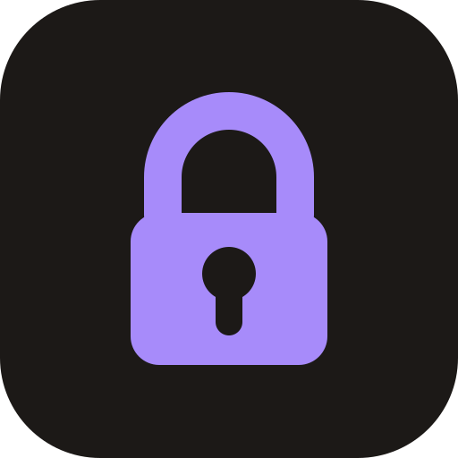
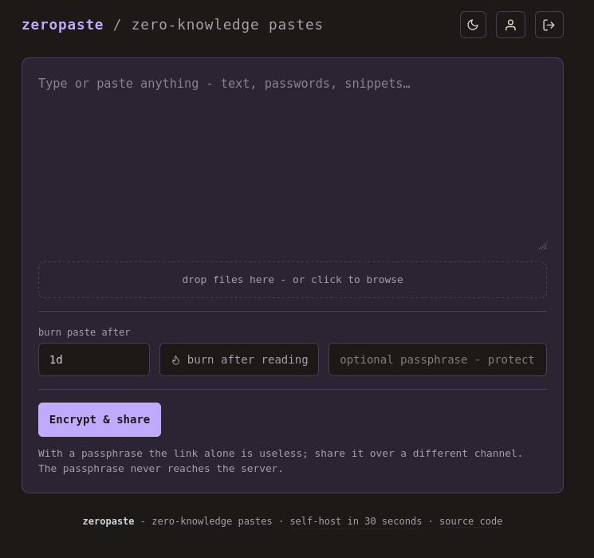

<p align="center">
  
</p>

# zeropaste

<p align="center">
  <a href="https://github.com/2TAP2B/zeropaste/releases/latest"></a>
  <a href="LICENSE"></a>
  
  <a href="https://github.com/2TAP2B/zeropaste/actions/workflows/docker.yml"></a>
  <a href="https://2tap2b.github.io/zeropaste/"></a>
</p>

<p align="center">
  <a href="https://2tap2b.github.io/zeropaste/"><b>read the docs</b></a> · <a href="https://zero.sohn.uk/"><b>try demo</b></a>
</p>

<p align="center">
  
</p>

Self-hosted, zero-knowledge paste sharing in a single Go binary: the browser encrypts your paste with AES-256-GCM before it ever hits the wire, and the decryption key rides in the URL fragment, which browsers never send anywhere. Everything is anonymous by default - no sign-up, no cookies, no request logs - with optional passkey accounts for a private dashboard of your active shares.

## Features

- **Single binary** - all frontend assets embedded, no CDN calls anywhere
- **Zero-knowledge** - per-paste random key in the URL fragment, stripped from the bar after decrypt
- **Passphrase mode** - PBKDF2-SHA-256, 600k iterations + random salt; the link alone is useless
- **Burn after reading, free-form TTL** - `10m` to `30 days`, swept by a janitor
- **Encrypted file bundles** - client-side manifests, image thumbnails, click-to-open lightbox
- **Reverse shares** - drop links that collect uploads from others; only your browser holds the key
- **Public pastes (opt-in)** - an accounts-only plaintext lane with optional custom slugs
- **Optional passkey accounts** - private share dashboard, admin config, invite links
- **Hardened defaults** - strict CSP, nosniff, DENY framing, no-referrer, per-IP rate limit, no request logs

## Setup

The easiest and recommended way is Docker, ~9 MB image from GHCR, nothing to build:

```sh
docker run -d --name zeropaste -p 8080:8080 -v paste-data:/data ghcr.io/2tap2b/zeropaste:latest
```

Open the address and share. A NixOS module ships in the flake, and every knob is one commented line in `compose.yaml`. The [documentation](https://2tap2b.github.io/zeropaste/guide/getting-started) carries the setup guide, configuration, security model and the API reference.

## Contributing

PRs welcome, but respect the constraints: single binary, one Go module dependency (passkeys only - no web frameworks, no DB drivers), English UI, no accounts beyond the optional passkey system. Run `gofmt -l .`, `go vet ./...`, `go test ./...`, `tsc --noEmit`, and regen the bundle (`esbuild --bundle web/ts/app.ts --outfile=web/assets/app.js --minify --target=es2020`) before submitting; add a test for every abuse case before adding the mitigation.

## AI usage

This app was built with the help of AI - mostly with local Qwen3.8 27B, together with the omp agent, and with GLM-5.3 Flash as advisor.
