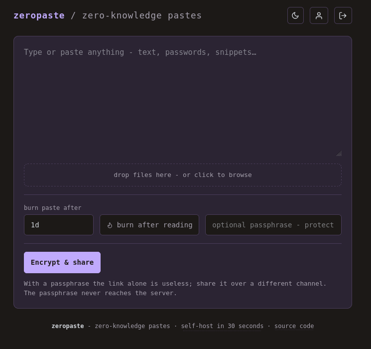

# zeropaste

<p align="center">
  <a href="https://github.com/2TAP2B/zeropaste/releases/latest"></a>
  <a href="LICENSE"></a>
  
  <a href="https://github.com/2TAP2B/zeropaste/actions/workflows/docker.yml"></a>
</p>

Self-hosted, zero-knowledge paste sharing in a single Go binary: the browser encrypts your paste with AES-256-GCM before it ever hits the wire, and the decryption key rides in the URL fragment, which browsers never send anywhere. Everything is anonymous by default - no sign-up, no cookies, no request logs - with optional passkey accounts for a private dashboard of your active shares.

<p align="center">
  
</p>

## Features

- **Single binary** - all frontend assets embedded, no CDN calls anywhere
- **Zero-knowledge** - per-paste random key in the URL fragment, stripped from the bar after decrypt
- **Passphrase mode** - PBKDF2-SHA-256, 600k iterations + random salt; the link alone is useless
- **Burn after reading, free-form TTL** - `10m` to `30 days` (`MAX_TTL_DAYS`), swept by a janitor
- **Encrypted file bundles** - client-side manifests, image thumbnails, click-to-open lightbox
- **Clipboard paste** - Ctrl+V anywhere attaches images to the upload section
- **Syntax highlighting + QR codes** - vendored highlight.js and qrcode-generator, rendered locally
- **Light/dark theme** - system default plus toggle, responsive down to phones
- **Optional create-gate** - one site passphrase in front of creates (`CREATE_KEY`); reads stay public
- **Optional passkey accounts** - private share dashboard (`/dash`) with copy/delete per row; the server never sees content
- **Hardened defaults** - strict CSP, nosniff, DENY framing, no-referrer, per-IP rate limit, slowloris timeouts

## Install

Self-host in 30 seconds - image from GHCR, ~9 MB, nothing to build:

```sh
docker run -d --name zeropaste -p 8080:8080 -v paste-data:/data ghcr.io/2tap2b/zeropaste:latest
```

Open the address and share. That single line is already fully zero-knowledge and anonymous. All knobs (create-gate, accounts, TTL ceiling, share caps) live in `compose.yaml`, every one commented, so a fresh deploy never surprises:

```yaml
services:
  paste:
    image: ghcr.io/2tap2b/zeropaste:latest
    ports:
      - "8080:8080"
    volumes:
      - paste-data:/data
    restart: unless-stopped
    # environment:                 # all optional
    #   CREATE_KEY: "change-me"       # site passphrase in front of creates
    #   USER_ACCOUNTS: "true"         # "false" disables accounts entirely
    #   USER_REGISTRATION: "true"     # "false": sign-up closes after the first account
    #   MAX_TTL_DAYS: "30"            # share-time ceiling in days (1..366)
    #   MAX_SHARES_PER_ACCOUNT: "0"   # active shares per account; 0 = unlimited
volumes:
  paste-data:
```

The app UI carries the same two blocks - footer → **self-host in 30 seconds**.

### NixOS

First-class: the repo ships a hardened NixOS module (`flake.nix` + `module.nix`, no external flake inputs). Run it with `nix develop` tooling or pull the flake into your system configuration:

```nix
# your flake.nix
inputs.zeropaste.url = "github:2tap2b/zeropaste";

# inside nixosConfigurations.<host>
imports = [ inputs.zeropaste.nixosModules.zeropaste ];
services.zeropaste = {
  enable = true;
  listenAddress = "127.0.0.1:8080"; # loopback default; your reverse proxy does TLS
  # createKeyFile = ./create.key;    # file with a CREATE_KEY=<secret> line; secrets stay out of the store
  # registrationOpen = false;        # lock passkey sign-ups
};
```

Under the hood: `DynamicUser` with `StateDirectory=zeropaste` (`/var/lib/zeropaste` holds the 0600 JSON store), `Restart=on-failure`, and a tight systemd sandbox (NoNewPrivileges, ProtectSystem=strict, PrivateDevices, CapabilityBoundingSet empty, syscall filter). Env knobs beyond the module's options ride in through your own config - the service attrset merges:

```nix
systemd.services.zeropaste.environment = {
  MAX_UPLOAD = "536870912"; # 512 MiB
  MAX_TTL_DAYS = "14";
};
```

The package derivation is a plain `buildGoModule` (`CGO_ENABLED=0`, stripped); `flake.packages.x86_64-linux.default` builds it standalone with `nix build github:2tap2b/zeropaste`.

From source (Go 1.26+, matches go.mod):

```sh
git clone https://github.com/2TAP2B/zeropaste && cd zeropaste
go build -trimpath -ldflags="-s -w" -o paste .
./paste                     # http://127.0.0.1:8080
```

Production: the app speaks plain HTTP and is proxy-agnostic. Put any TLS-capable reverse proxy in front; HSTS belongs there, not in the app. The rate limiter reads the last `X-Forwarded-For` entry, which is what a typical proxy appends. Shares links are built in the browser from the address you opened, so there is no base-URL config and never will be.

## Configuration

Every value is optional; unset means the default. Set them via `environment:` in compose.yaml or plain env:

| env | default | what it does |
|---|---|---|
| `CREATE_KEY` | _(unset)_ | site passphrase in front of `POST /api/paste` and bundle creates; reads stay public - the link is the capability. **Presence is the switch.** |
| `USER_ACCOUNTS` | `true` | `false` switches the whole identity subsystem off: no registration, no sign-in, no dashboard rows - the app runs anonymous-only. |
| `USER_REGISTRATION` | `true` | `false` = first-user bootstrap: sign-up stays open only until the first account exists, then closes (sign-ins keep working). |
| `REG_OPEN` | `true` | static registration kill switch (useful after the first account; sign-ins always stay open). |
| `MAX_TTL_DAYS` | `30` | share-time ceiling in days (1–366); enforced on text pastes and file bundles alike. |
| `MAX_SHARES_PER_ACCOUNT` | `0` (unlimited) | cap on active shares per account; beyond it creations answer `403 share limit reached`. |
| `MAX_UPLOAD` | `104857600` (100 MiB) | total ciphertext per file bundle (1 MiB–64 GiB). The "maximum upload size" knob. |
| `CHUNK` | `8388608` (8 MiB) | bytes per upload/range chunk (64 KiB–64 MiB). |
| `SESSION_SECRET` | auto-generated | HMAC key for account session cookies; set it when the data dir does not persist it. |

## How it works

Random-key flow: the browser generates 32 random bytes, encrypts (AES-256-GCM, 12-byte IV), uploads `base64url(iv || ciphertext)`. The key goes into `https://your.host/p/<id>#<keyB64>`. Fragments never leave the browser, so neither server logs nor proxies ever see the key. The reader decrypts locally, then `history.replaceState` removes the key from the address bar.

Passphrase flow: 16-byte salt goes to the server, the key is derived in the browser from passphrase + salt (PBKDF2, 600k iterations). The link contains no key; the passphrase never touches the network.

Burn: for random-key pastes the server deletes the file right after the first fetch. For passphrase pastes the client sends `DELETE` only after a successful decrypt. A janitor goroutine removes expired files every minute. Everything is a 0600 JSON file in a 0700 directory - no database. Share links are assembled client-side from `location.origin`; the server never knows its public hostname.

File bundles: the client frames everything into one server-opaque envelope - `manifestCt ‖ file cts ‖ thumb cts`, all encrypted with one AES-GCM key per share. The manifest (names, MIME types, note text) never leaves the browser; the server sees only block lengths and an expiry.

## Security model

- Keys exist only in the browser; the server cannot read any paste, compromised or subpoenaed
- Anonymous use stores only ciphertext, salt, and an expiry timestamp - no IPs, no request logs, no tracking pixels
- When passkey accounts are enabled, the server additionally stores identity names, WebAuthn public-key material, and HMAC-signed session cookies (`zp.session`, HttpOnly, SameSite=Lax) - still never paste content or keys; `USER_ACCOUNTS=false` reduces the server to the anonymous footprint
- Create-gate passphrase is per-tab in `sessionStorage`, never persisted; the only `localStorage` entry is the theme choice (`zp.theme`) - a UI preference, not data
- Supply chain: one direct Go dependency (`go-webauthn` for passkey support), audited with `govulncheck` in the release gate; vendored highlight.js and qrcode-generator are committed and served from the binary, never hotlinked
- Advanced: strict CSP (`default-src 'self'; img-src 'self' blob:`), `X-Content-Type-Options`, `X-Frame-Options: DENY`, `Referrer-Policy: no-referrer`, body caps, per-IP fixed-window limiter, constant-time key comparison
- Paste rendering uses `textContent` only - `innerHTML` with paste content does not exist

For full details, read [AGENTS.md](AGENTS.md) - the complete spec.

## Contributing

PRs welcome, but respect the constraints: single binary, one Go module dependency (passkeys only - no web frameworks, no DB drivers), English UI, no accounts beyond the optional passkey system. Run `gofmt -l .`, `go vet ./...`, `go test ./...`, `tsc --noEmit`, and regen the bundle (`esbuild --bundle web/ts/app.ts --outfile=web/assets/app.js --minify --target=es2020`) before submitting; add a test for every abuse case before adding the mitigation.

## AI usage

This app was built with the help of AI - mostly with local Qwen3.8 27B, together with the omp agent, and with GLM-5.3 Flash as advisor.
