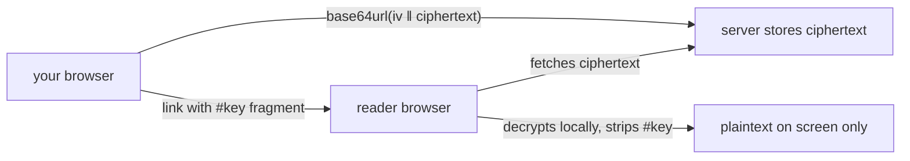

# shares

Everything in zeropaste is a share: text, a bundle of files, or a reverse-share drop link. This page covers ordinary shares.

## the encryption model

When you hit **Encrypt & share**, the browser does the crypto - not the server:

1. A random 256-bit key is generated in the tab.
2. The content is encrypted with **AES-256-GCM** (WebCrypto, always on).
3. The payload the server receives is `iv ‖ ciphertext`, base64url - no plaintext, no key, no metadata beyond what you see on the paste itself.
4. The key rides the **URL fragment**: `/p/<id>#<key>`. Fragments are never sent to servers, proxies or access logs. After decryption the link strips itself from the address bar.

The reader's browser fetches the ciphertext, decrypts with the fragment key and shows the result. The server could not read a single byte if it wanted to - there is no plaintext to subpoena, leak or log.

## ttl

Every paste carries a lifetime, set in the compose row as free text: `1d`, `6H`, `10 min`, `30 days` - parsed case-insensitively, from **one minute up to 30 days** (the instance ceiling is configurable; compounds like `1h30m` are not). Expired pastes are swept away within a minute; reading one answers 404.

## burn after reading

The flame toggle marks a paste **burn after reading**:

- **random-key pastes**: deleted on the first successful read (read-then-delete). Two racing readers can both land - accepted ceiling for a friend-group tool.
- **passphrase pastes**: never deleted by reading. The paste stays until you delete it - a wrong passphrase from a link unfurler must not destroy your data.

Burn bundles get a 30-second grace window so the legitimate reader can finish downloading all chunks.

## passphrase protection

Instead of a random key you can protect a paste with a shared passphrase:

- the browser derives the key from passphrase + a fresh 16-byte salt (**PBKDF2-HMAC-SHA256, 600,000 iterations** - the OWASP figure);
- the server stores the salt only; the passphrase never leaves the browser;
- the link is a bare `/p/<id>` with **no fragment** - share the passphrase over a different channel.

## public (plaintext) pastes

Signed-in users can flip the `public paste` slider to send a paste **unencrypted** - for a want-to-be-googleable note or a pastebin-style mirror. The server stores and serves exactly what was sent, the link has no key at all, and creation is always account-only. Instances can switch the feature off (`PUBLIC_PASTES=false` or the admin config).

## links and QR

Share URLs are built from whatever address the browser is on (`location.origin`) - the server never learns its own public domain. Every created paste offers a copyable link and a client-rendered QR code.
